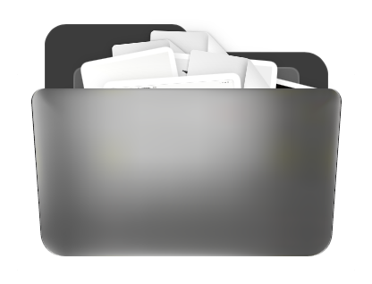
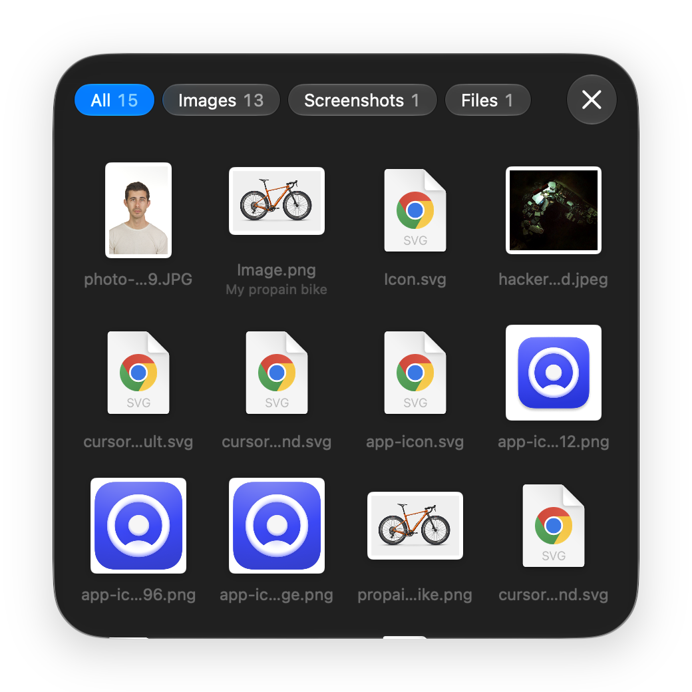
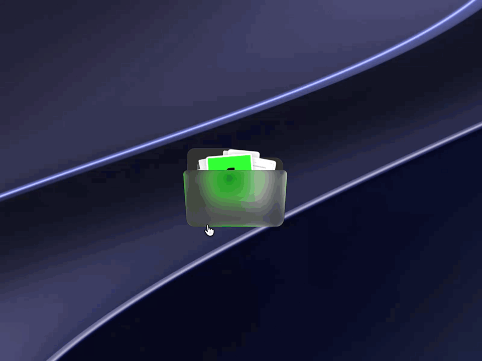

# Cubby

A little folder that lives on your Mac's desktop. Drop in files, images, screenshots, links, colors or text, and grab them again when you need them.

<p align="center">
  
  &nbsp;&nbsp;
  
</p>

<p align="center">
  
</p>

## What it does

- **Keeps things close.** Cubby sits anywhere you like on the desktop as a small glass folder, with your newest items peeking out of the top.
- **Takes anything.** Drag in files, images, links, text or colors. Files from the Desktop move in, so your desktop stays clean.
- **Opens into a card.** Click the folder to see everything in a grid, sorted into tabs: Images, Screenshots, Files, Links, Colors and Text. Start typing to find something.
- **Gives it back.** Drag an item out to wherever you need it, or grab the papers sticking out of the folder to take everything at once.
- **Comes to you.** Dragging something in another app? Give it a quick shake, and Cubby pops up in the middle of the screen, ready for the drop.
- **Catches screenshots.** Turn it on, and new screenshots go straight into Cubby instead of piling up on the desktop.

### Handy extras

- Copy a color as HEX, RGB, HSL or SwiftUI.
- Convert images to JPEG, PNG or HEIC, or make them smaller.
- Compress a selection into a zip, or share it.
- Rename anything and add a note to it.
- Press Space to preview, Delete to move items to the Bin.
- Pin the folder above all windows on every desktop.
- Choose the folder and item sizes, and light or dark appearance.

Nothing is ever deleted for good: anything you remove goes to the Bin.

## Requirements

macOS 26 (Tahoe) or later.

## Build

```bash
Scripts/make-app.sh
```

This builds `Cubby.app` in the project folder. Move it to Applications and open it.

`Scripts/make-app.sh --test` builds `Cubby-Test.app` instead, which keeps its items separate from the real app.
